<div align="center">
  <picture>
    <source media="(max-width: 600px)" srcset="./assets/hero-mobile.svg" />
    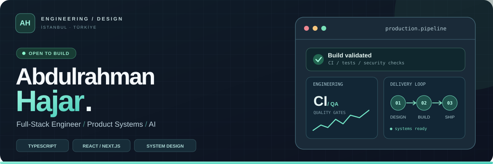
  </picture>

  <p><strong>Thoughtful interfaces. Reliable systems. Software built to last.</strong></p>
  <p>Computer Engineering · Istanbul, Türkiye · TypeScript-first engineering</p>

  <p>
    <a href="https://abdulrahman-hajar-portfolio.onrender.com">Explore portfolio</a> &nbsp;·&nbsp;
    <a href="https://abdulrahman-hajar-portfolio.onrender.com/resume/">Résumé</a> &nbsp;·&nbsp;
    <a href="https://www.linkedin.com/in/abdulrahman-hajjar-5430281a1/">LinkedIn</a> &nbsp;·&nbsp;
    <a href="https://github.com/rahman-997?tab=repositories">All repositories</a>
  </p>
</div>

<div align="center">
  <a href="https://github.com/rahman-997/portfolio/actions/workflows/ci.yml"></a>
  <a href="https://github.com/rahman-997/portfolio/actions/workflows/security.yml"></a>
  <a href="https://github.com/rahman-997/rahman-997/actions/workflows/link-health.yml"></a>
</div>

<p align="center">
  <a href="#about-my-work">About</a> &nbsp;·&nbsp;
  <a href="#find-your-starting-point">Start here</a> &nbsp;·&nbsp;
  <a href="#selected-work">Featured projects</a> &nbsp;·&nbsp;
  <a href="#evidence-and-verification-map">Proof map</a> &nbsp;·&nbsp;
  <a href="#lets-connect">Contact</a>
</p>

<details>
<summary>Explore more topics</summary>

<p><strong>Systems &amp; data</strong></p>
<p>
  <a href="#systems-behind-the-screens">Architecture</a> ·
  <a href="#decisions-in-context">Decision guide</a> ·
  <a href="#api-and-data-contracts">API contracts</a> ·
  <a href="#data-ownership-and-privacy">Privacy</a> ·
  <a href="#resilience-and-recovery">Recovery</a> ·
  <a href="#observability-and-service-signals">Observability</a>
</p>
<p><strong>Product &amp; accessibility</strong></p>
<p>
  <a href="#design-systems-and-interface-craft">Design craft</a> ·
  <a href="#user-journeys-and-interface-states">UI states</a> ·
  <a href="#performance-and-accessible-ux">Performance &amp; UX</a> ·
  <a href="#languages-and-inclusive-ux">Languages</a> ·
  <a href="#rtl-and-localization-qa">Localization QA</a>
</p>
<p><strong>Quality &amp; delivery</strong></p>
<p>
  <a href="#engineering-principles">Principles</a> ·
  <a href="#delivery-end-to-end">Delivery</a> ·
  <a href="#quality-and-security">Quality &amp; security</a> ·
  <a href="#verification-ladder">Verification ladder</a> ·
  <a href="#incident-response-rehearsal">Incident rehearsal</a> ·
  <a href="#from-feature-brief-to-acceptance-test">Acceptance criteria</a>
</p>
<p><strong>Practice &amp; learning</strong></p>
<p>
  <a href="#engineering-toolkit">Toolkit</a> ·
  <a href="#ai-and-automation-lab">AI lab</a> ·
  <a href="#collaboration-and-handoff">Collaboration</a> ·
  <a href="#technical-writing-and-decisions">Technical notes</a> ·
  <a href="#developer-experience-and-reproducibility">Developer experience</a> ·
  <a href="#explore-the-code">Code tour</a> ·
  <a href="#questions-i-am-exploring">Exploring</a>
</p>

</details>

## About my work

I turn complex ideas into **production-minded web products**, balancing the details people see with the architecture they don't. My work spans responsive React/Next.js experiences, APIs, data consistency, background jobs, automated tests, security, and deployment.

**Product craft** · Accessible, responsive UI · React · Next.js · TypeScript

**Systems thinking** · API boundaries · PostgreSQL · MongoDB · Redis · queues

**Delivery discipline** · Automated testing · GitHub Actions · Docker · production checks

## Find your starting point

**Looking for a specific engineering challenge?** Start with the project that demonstrates it, then follow the source or case study for details.

- **Reliable booking and background work:** [Eventify](https://github.com/rahman-997/eventify) covers event workflows, waitlists, workers and delivery checks.
- **Checkout and data integrity:** [BookHaven](https://github.com/rahman-997/bookbookhaven) explores inventory, authentication and commerce flows.
- **Accessible, installable UX:** [FitFlow](https://github.com/rahman-997/fitflow-gym) focuses on guided interactions, local state and PWA behavior.
- **Privacy-conscious multilingual UI:** [Mizan Finance](https://github.com/rahman-997/mizan-finance) brings together RTL interfaces and local-first finance tracking.
- **Clear backend contracts:** [Venues API](https://github.com/rahman-997/venues-api) demonstrates input validation, REST boundaries and endpoint testing.

## Selected work

*A curated first look at backend reliability, commerce and privacy-first product design. Every project links to its source so you can verify the implementation.*


### Eventify · Distributed event bookings

<a href="https://eventify-web.onrender.com">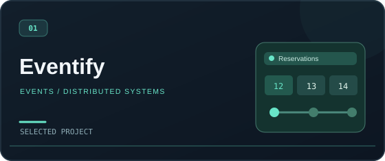</a>

Bookings, waitlists, a durable outbox, background workers, health/readiness checks, metrics and security-focused CI.

`TypeScript` · `Express` · `PostgreSQL` · `Redis` · `BullMQ`  
[Live](https://eventify-web.onrender.com) · [Source](https://github.com/rahman-997/eventify) · [Case study](https://abdulrahman-hajar-portfolio.onrender.com/work/eventify/)

---


### BookHaven · Full-stack commerce

<a href="https://bookbookhaven-free.onrender.com">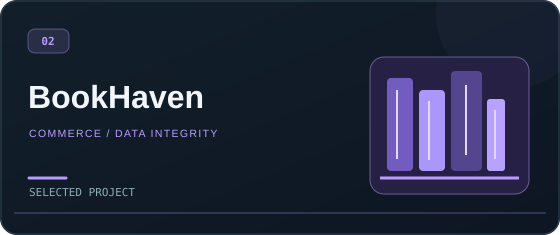</a>

Authentication, concurrency-safe checkout, inventory integrity, admin workflows and production verification.

`Next.js` · `React` · `TypeScript` · `MongoDB` · `Zod`  
[Live](https://bookbookhaven-free.onrender.com) · [Source](https://github.com/rahman-997/bookbookhaven) · [Case study](https://abdulrahman-hajar-portfolio.onrender.com/work/bookhaven/)

---


### Mizan Finance · Privacy-first finance planner

<a href="https://mizan-finance-rahman-997.netlify.app">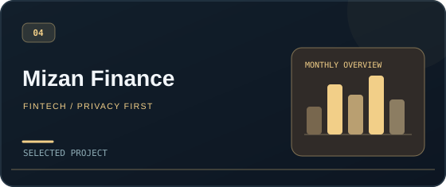</a>

Bilingual UX with RTL support, local persistence, validated workflows and readable charts.

`React` · `TypeScript` · `Zod` · `Recharts`  
[Live](https://mizan-finance-rahman-997.netlify.app) · [Source](https://github.com/rahman-997/mizan-finance)

---


<details>
<summary><strong>More projects: FitFlow, Venues API &amp; engineering portfolio</strong></summary>

Three more ways to explore accessible UX, backend contracts and product case studies.

### FitFlow · Installable fitness PWA

<a href="https://fitflow-gym.onrender.com">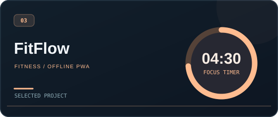</a>

Guided intervals, local persistence, accessible interactions and offline-ready behavior.

`Next.js` · `React` · `TypeScript` · `PWA`  
[Live](https://fitflow-gym.onrender.com) · [Source](https://github.com/rahman-997/fitflow-gym) · [Case study](https://abdulrahman-hajar-portfolio.onrender.com/work/fitflow/)

---


### Venues API · Contract-driven backend

<a href="https://github.com/rahman-997/venues-api">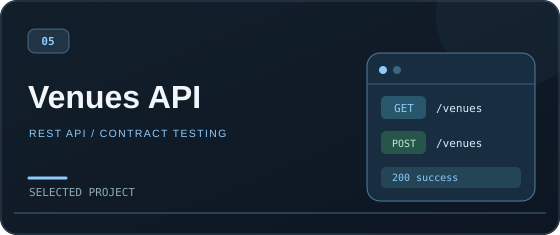</a>

Layered REST architecture, edge validation, centralized error handling, UUID resources and HTTP contract tests.

`Node.js` · `Express` · `TypeScript` · `Zod`  
[Health endpoint](https://venues-api-rahman.onrender.com/health) · [Source](https://github.com/rahman-997/venues-api) · [Case study](https://abdulrahman-hajar-portfolio.onrender.com/work/venues-api/)

---


### Engineering Portfolio · Work, explained

<a href="https://abdulrahman-hajar-portfolio.onrender.com">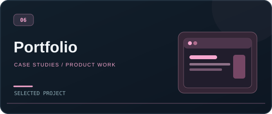</a>

A place to explore deployed products, source repositories and deeper architecture case studies.

`Projects` · `Architecture` · `Case studies`  
[Visit portfolio](https://abdulrahman-hajar-portfolio.onrender.com) · [Résumé](https://abdulrahman-hajar-portfolio.onrender.com/resume/)


</details>

## Evidence and verification map

**Follow the evidence, not just the headline.** Each path below points to something inspectable and explains the type of question it can answer.

- **API boundaries:** [Venues API source](https://github.com/rahman-997/venues-api), inspect request validation, HTTP contracts and predictable errors.
- **Background workflows:** [Eventify source](https://github.com/rahman-997/eventify), inspect queues, worker paths and service health checks.
- **User-facing states:** [FitFlow source](https://github.com/rahman-997/fitflow-gym), inspect PWA behavior, interaction states and keyboard handling.
- **RTL &amp; local-first UX:** [Mizan Finance source](https://github.com/rahman-997/mizan-finance), inspect data ownership and bilingual interface choices.
- **Profile quality:** [Profile workflow](https://github.com/rahman-997/rahman-997/actions/workflows/link-health.yml), review local tests and separately scheduled link checks.

**A workflow badge is not proof of every behavior and not a guarantee of live availability.** Review source, relevant tests, deployment context and the most recent workflow results together.

## Let's connect

Open to **frontend and full-stack engineering opportunities** where thoughtful product work and dependable systems matter. Start with the [live portfolio](https://abdulrahman-hajar-portfolio.onrender.com), browse [my repositories](https://github.com/rahman-997?tab=repositories), or connect through [LinkedIn](https://www.linkedin.com/in/abdulrahman-hajjar-5430281a1/).

<details>
  <summary><strong>نبذة بالعربية</strong></summary>
  <p dir="rtl" align="right">أنا مهندس كمبيوتر ومطوّر Full-Stack مقيم في إسطنبول. أعمل على بناء تطبيقات ويب متكاملة، من تصميم الواجهات وتجربة المستخدم إلى هندسة الخوادم وقواعد البيانات، مع التركيز على الجودة والأمان والاختبارات وقابلية الصيانة.</p>
</details>

## Engineering toolkit

**Frontend & experience** · React, Next.js, TypeScript, responsive UX, accessibility, PWAs

**Backend & data** · Node.js, Express, PostgreSQL, Prisma, MongoDB, Redis, REST, queues

**Quality & operations** · Automated testing, Docker, CI/CD, security scanning, observability, release verification

**Additional interests** · GraphQL, WebSockets, gRPC, OpenAPI, AI/LLM/MCP, FastAPI, Flutter

## Systems behind the screens

*The rest of this page is a technical field guide. For a shorter visit, the [projects](#selected-work), [proof map](#evidence-and-verification-map) and [contact links](#lets-connect) above are the best starting points.*

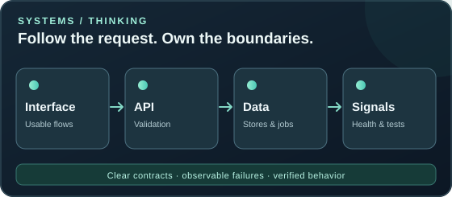

The best implementation is not just a collection of technologies. It is a set of explicit decisions about **where data lives, how failure is handled and what can be verified**.

- **Asynchronous workflows:** Eventify separates booking requests from worker-driven tasks and makes system health visible. [Explore the source](https://github.com/rahman-997/eventify).
- **Integrity at checkout:** BookHaven treats inventory and checkout as consistency problems, not just UI states. [Explore the source](https://github.com/rahman-997/bookbookhaven).
- **Validation at the edge:** Venues API keeps request validation, error handling and HTTP contracts clear. [Explore the source](https://github.com/rahman-997/venues-api).
- **User control over data:** Mizan Finance takes a local-first approach with bilingual interfaces. [Explore the source](https://github.com/rahman-997/mizan-finance).

## Decisions in context

<picture>
  <source media="(max-width: 600px)" srcset="./assets/decision-paths-mobile.svg" />
  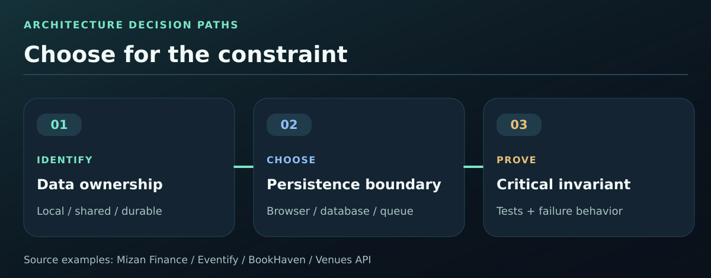
</picture>

**A pattern is only helpful when it matches the constraint.** Here is a practical trade-off guide grounded in the public projects, not a recommendation to use every technology everywhere.

- **Private, device-owned planning data:** Choose local-first state with explicit backup and restore. Inspect [Mizan Finance](https://github.com/rahman-997/mizan-finance) for its storage decisions.
- **Durable booking intent and asynchronous follow-up:** Keep authoritative records in the database and defer follow-up work to a queue. Inspect [Eventify](https://github.com/rahman-997/eventify) for PostgreSQL outbox and BullMQ workers.
- **Competing updates to shared inventory:** Protect invariants at the data boundary instead of trusting the interface. Inspect [BookHaven](https://github.com/rahman-997/bookbookhaven) for its checkout consistency model.
- **Small, readable HTTP service:** Prefer explicit validation and a simple persistence boundary. Inspect [Venues API](https://github.com/rahman-997/venues-api) for contracts and JSON storage.

**Questions before choosing:** Who owns the data? Can it be lost? Can two writers conflict? Must the task survive a restart? What is the smallest test that would prove the important invariant? This comparison illustrates decision criteria; it is **not a claim that these projects have identical infrastructure or service guarantees**.

## Engineering principles

**Architecture is a set of trade-offs, not a stack of logos.** These are the questions I use to make technical decisions easier to explain and review:

- **Where should state live?** Keep temporary UI state local, persist durable decisions explicitly, and make synchronization rules visible.
- **What happens when a request fails?** Design loading, retry, validation and recovery paths before calling a flow finished.
- **Who owns each boundary?** Use clear API contracts and predictable errors instead of letting implementation details leak across layers.
- **How will we know it works?** Pair useful tests with health signals and observable outcomes; avoid relying solely on a polished demo.

I aim for the smallest design that handles real constraints. More components, queues or abstractions only help when they solve a demonstrated problem.

## Design systems and interface craft

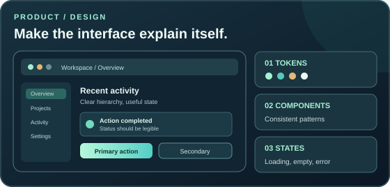

A polished UI is a set of **repeatable decisions**, not a collection of isolated screenshots. My design process links the visual system to actual interface behavior:

- **Tokens before decoration:** establish typography, spacing, colors and contrast so new screens feel related.
- **Patterns over one-offs:** use predictable navigation, forms, feedback and component states across the product.
- **Real states matter:** design loading, empty, error, validation and success experiences alongside the happy path.

For practical UI source, start with [FitFlow's interaction patterns](https://github.com/rahman-997/fitflow-gym) and [Mizan Finance's multilingual layouts](https://github.com/rahman-997/mizan-finance). The illustration shows a design approach, not a screenshot or claim of a specific shared design-system library.

## User journeys and interface states

<picture>
  <source media="(max-width: 600px)" srcset="./assets/user-journeys-mobile.svg" />
  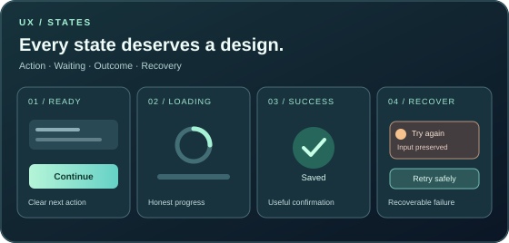
</picture>

**The screen is a conversation with the user, including when nothing happens as expected.** I design complete interaction paths rather than just their final screenshot:

- **Before action:** show the next step clearly, with accessible names and sensible defaults.
- **In progress:** preserve context, show honest loading feedback, and avoid encouraging duplicate actions.
- **No content yet:** provide a useful empty state instead of a blank canvas.
- **Success or failure:** explain the outcome, offer a recoverable next action, and keep keyboard focus predictable.

See [FitFlow's guided interaction patterns](https://github.com/rahman-997/fitflow-gym) for a relevant implementation to inspect. This is an interface-design checklist; individual behaviors should be verified in the current source and on real devices.

## From feature brief to acceptance test

**A well-scoped feature is reviewable before anybody writes UI code.** I turn a request into a small contract between the user experience, the data rules, and the tests.

**Example brief: prevent overselling the last item in an online bookstore.** Reference implementation to inspect: [BookHaven source](https://github.com/rahman-997/bookbookhaven). The scenarios below illustrate acceptance thinking; check the repository tests for exact implemented behavior.

- **Happy path:** Given one available copy, When one customer completes a valid checkout, Then the order is recorded and remaining stock is consistent.
- **Conflict path:** Given two overlapping checkout requests for the final copy, When both attempt to confirm, Then the system must not commit more sales than inventory allows.
- **Failure path:** Given invalid session or payment details, When checkout is attempted, Then a clear error is returned without a partially accepted order.
- **UX and accessibility:** Given a keyboard or screen reader user, When a submission is pending or rejected, Then progress, focus and feedback remain understandable without relying on color alone.

**Definition of done:** identify the data invariant, link its automated tests, verify one representative user flow, and document what the demo environment cannot guarantee. This keeps a feature spec focused on observable behavior rather than screenshots alone.

## API and data contracts

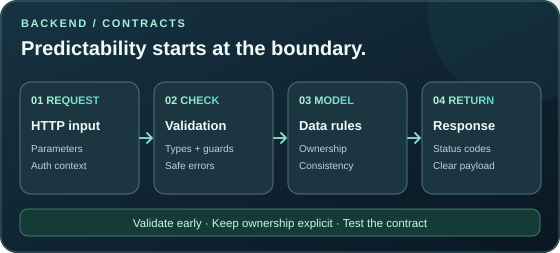

Useful APIs make invalid requests predictable and important rules easy to locate. A contract-focused checklist helps connect the interface to the data model:

1. **Define the boundary:** input shape, authorization context and meaningful status codes.
2. **Validate before mutation:** reject inconsistent input with actionable error messages.
3. **Protect invariants:** handle ownership and concurrency at the data layer rather than trusting the UI.
4. **Verify the behavior:** test valid, invalid and conflicting requests before a release.

Compare the focused endpoint design in [Venues API](https://github.com/rahman-997/venues-api) with commerce-oriented integrity concerns in [BookHaven](https://github.com/rahman-997/bookbookhaven). These are investigation pointers, not claims that both repositories implement every pattern listed above.

## Data ownership and privacy

**Data privacy starts with choosing what not to collect.** I think about information flows before deciding where to persist data or how to synchronize it.

1. **Minimize:** request only the fields the feature genuinely needs, and explain why.
2. **Separate:** keep transient UI state, device-local preferences and server-owned records distinct.
3. **Protect:** define access controls, safe defaults, retention expectations and recovery paths where relevant.
4. **Explain:** make export, reset or deletion behavior understandable instead of burying it in a settings screen.

[Mizan Finance](https://github.com/rahman-997/mizan-finance) is a useful public example of local-first product thinking. The points above are design principles, **not a claim that every linked project implements each privacy control**.

## Delivery, end to end

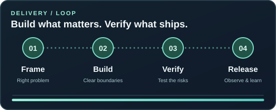

1. **Frame the problem.** Clarify users, constraints, edge cases and a useful definition of done.
2. **Shape the system.** Build responsive interfaces with understandable API and data boundaries.
3. **Prove the behavior.** Cover important paths with tests and review accessibility and security assumptions.
4. **Release and learn.** Automate checks, verify the running product and improve from evidence.

I prefer practical quality gates to decorative badges: [portfolio CI](https://github.com/rahman-997/portfolio/actions/workflows/ci.yml) and [security workflow](https://github.com/rahman-997/portfolio/actions/workflows/security.yml) are examples of the checks linked to this profile.

> Clear ownership over cleverness. Simple systems are only simple when the hard decisions have been made.

## Quality and security

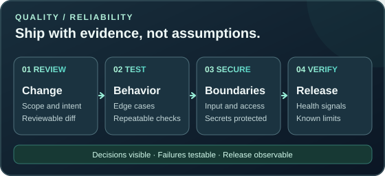

**Quality is something to check, not something to claim.** My preferred release checklist covers four different failure modes:

1. **Correctness:** exercise the happy path, edge cases and failure responses through repeatable tests.
2. **Security boundaries:** validate untrusted input, protect sensitive data, scope permissions and keep secrets out of source control.
3. **Operational readiness:** make configuration explicit, report useful failures and verify the service after deployment.
4. **Maintainability:** keep changes small enough to review and document important decisions in the codebase.

You can inspect the publicly visible checks for the [portfolio CI](https://github.com/rahman-997/portfolio/actions/workflows/ci.yml), [security scans](https://github.com/rahman-997/portfolio/actions/workflows/security.yml), and this profile's [README/link checks](https://github.com/rahman-997/rahman-997/actions/workflows/link-health.yml). A green badge is a signal about a workflow, **not** a blanket security guarantee.

## Verification ladder

<picture>
  <source media="(max-width: 600px)" srcset="./assets/verification-ladder-mobile.svg" />
  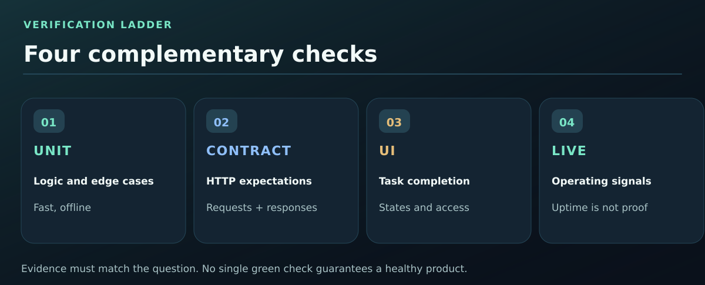
</picture>

**One green check cannot prove the whole product.** I look for several forms of evidence, each answering a different question:

- **Unit checks:** Does a small decision work across edge cases? Start with this profile's [offline tests](./tests/profile-audit.test.mjs).
- **Contract tests:** Do invalid requests and response shapes behave predictably? Inspect [Venues API](https://github.com/rahman-997/venues-api).
- **UI flows:** Can someone finish a task on a real screen, including error states? Inspect [Mizan Finance](https://github.com/rahman-997/mizan-finance).
- **Live signals:** Is a deployed service responding and reporting useful failures *now*? Inspect [Eventify](https://github.com/rahman-997/eventify).

The ladder is a **review model**, not a claim that every repository has all four layers. Offline tests cannot prove uptime; live health checks do not prove accessibility, privacy or correct business rules. Read the actual test reports and environment notes before drawing conclusions.

## Performance and accessible UX

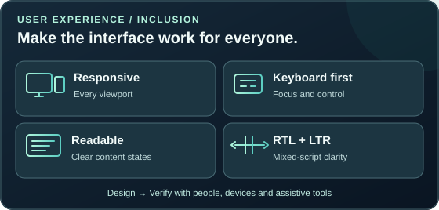

A fast interface is only useful when people can understand and operate it. I focus on fundamentals before celebrating a score:

- **Responsive by design:** readable layouts and controls on narrow screens, without hidden horizontal scrolling.
- **Interaction that works:** useful focus order, labelled controls, visible states and keyboard-friendly navigation.
- **Perceived performance:** lightweight assets, clear loading feedback and fewer unnecessary network requests.
- **Internationalization:** consistent dates, numbers, punctuation and RTL/LTR mixing without breaking typography.

[FitFlow](https://github.com/rahman-997/fitflow-gym) offers a source-level example of interactive PWA design; [Mizan Finance](https://github.com/rahman-997/mizan-finance) is a useful starting point for bilingual and RTL-aware interfaces. Performance and accessibility should be verified on real devices and with appropriate tools, not inferred from screenshots.

## Resilience and recovery

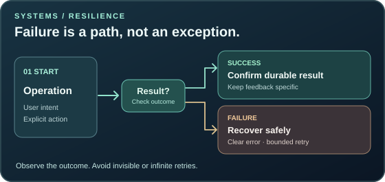

**The failure path is part of the experience.** I look for explicit answers to practical questions rather than treating network and worker errors as invisible implementation details:

- **Timeout or offline?** Show a useful state, preserve recoverable user input and make retry deliberate.
- **Duplicate submission?** Check whether a repeated operation must be safe or deduplicated.
- **Background work delayed?** Distinguish request acceptance from completion, and expose a meaningful status.
- **Incident or deployment issue?** Prefer observable signals and reversible changes over unexplained silence.

[Eventify's event and background-work architecture](https://github.com/rahman-997/eventify) is a useful source to inspect for asynchronous flow decisions. Individual guarantees must still be checked against its current implementation and tests.

## Incident response rehearsal

**A recovery plan is easier to trust when someone can walk through it.** This is a *hypothetical tabletop exercise*, not a record of a production incident or a claim of an installed on-call process.

1. **Detect and scope:** identify which route or worker is failing, when the issue began, and whether user data is at risk. Check health indicators and request IDs where available.
2. **Protect users:** disable or pause unsafe mutations when appropriate, show a useful temporary state, and avoid repeating irreversible operations automatically.
3. **Choose recovery:** decide whether a rollback, configuration correction, queue pause, or targeted repair is the safer route. Rehearse the decision rather than assuming redeploying fixes every incident.
4. **Verify and communicate:** assign an owner, record the affected scope and user-facing message, then verify the critical behavior again after recovery.
5. **Learn:** capture a small timeline, the missed signal and one preventive test or alert that would reduce recurrence.

For a system to investigate, start with [Eventify's health and background-work design](https://github.com/rahman-997/eventify). The real recovery procedure must follow the deployed system's infrastructure, permissions and documented data-consistency rules.

## Observability and service signals

<picture>
  <source media="(max-width: 600px)" srcset="./assets/service-signals-mobile.svg" />
  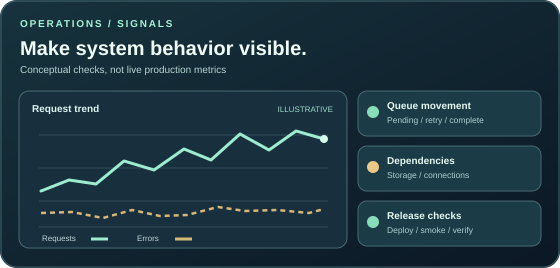
</picture>

**A service is more operable when its behavior can be explained.** Useful signals answer different questions, so I avoid treating a single green badge as a complete production health check:

- **Requests:** are users receiving expected responses, and where are failures concentrated?
- **Background work:** is the queue advancing, delayed or repeatedly retrying?
- **Dependencies:** can the app reach storage and the services it actually needs?
- **Release verification:** did the deployed version pass smoke checks after the change?

[Eventify](https://github.com/rahman-997/eventify) provides a good starting point for reviewing asynchronous work and health-related checks. Signal availability and monitoring depth depend on the deployed environment, so this diagram is a **review model rather than a live dashboard**.

## AI and automation lab

AI is an area I **explore and evaluate**, not a label I automatically put on every product. I am particularly interested in useful integrations that are measurable, permission-aware and maintainable.

- **AI-assisted product flows:** Make the source of information, user approval and failure handling visible.
- **Automation for developers:** Turn repetitive verification, documentation and release checks into repeatable workflows.
- **Responsible integrations:** Prefer clear tool boundaries, structured outputs and observable behavior over opaque one-off prompts.

**My rule:** A demo is a starting point. A dependable feature needs evaluation, safeguards and a path for recovery when something goes wrong.

## Languages and inclusive UX

**Languages I work with:** العربية · Türkçe · English · فارسی.

Multilingual design goes beyond translation. It means supporting right-to-left reading, mixed-script typography, accessible labels, dates, numbers and responsive layouts without losing visual clarity. [Mizan Finance](https://github.com/rahman-997/mizan-finance) is a practical example of RTL-aware product design.

<p dir="rtl" align="right"><strong>العربية:</strong> واجهات واضحة ومتجاوبة، مع احترام اتجاه النص وسهولة القراءة.</p>
<p dir="rtl" align="right"><strong>فارسی:</strong> طراحی رابط کاربری خوانا، با پشتیبانی درست از راست‌به‌چپ.</p>
<p><strong>Türkçe:</strong> Erişilebilir, anlaşılır ve tutarlı kullanıcı deneyimleri.</p>

## RTL and localization QA

**A translation can be linguistically correct and still break the interface.** I use a small visual and keyboard checklist when reviewing Arabic, Persian and mixed-direction screens. [Mizan Finance](https://github.com/rahman-997/mizan-finance) demonstrates English/Arabic localization; the Persian samples here illustrate an additional QA target, **not a claim that its interface ships in Persian**.

- **Direction and isolation:** set `dir="rtl"` on right-to-left passages; isolate filenames, links, currency amounts and code snippets so their order stays readable.
- **Persian orthography:** preserve the Persian letters **ی و ک** rather than replacing them with similar-looking Arabic variants; verify joined glyphs in an actual rendering.
- **Numbers and dates:** test mixed-digit receipts, punctuation, time formats, phone numbers and negative values without relying only on alignment.
- **Responsive stress:** inspect 390px and narrow layouts with long labels, translated buttons, charts and data tables.
- **Assistive technology:** verify heading order, focus movement, keyboard navigation, screen reader names and error announcements in the selected language.

<p dir="rtl" align="right"><strong>العربية:</strong> مراجعة اتجاه النصوص وعلامات الترقيم والأرقام داخل الواجهات متعددة اللغات.</p>
<p dir="rtl" align="right"><strong>فارسی:</strong> بررسی اتصال حروف، جای‌گذاری اعداد و نشانه‌گذاری در رابط راست‌به‌چپ.</p>

These are manual QA cases to **run and record**, not automated certifications. A screenshot alone cannot establish screen reader or keyboard behavior.

## Collaboration and handoff

**Good delivery includes the next person who opens the repository.** My preferred working style is to keep context and constraints visible rather than relying on unwritten assumptions.

- **At the start:** agree on the user problem, acceptance criteria, risks and what is deliberately out of scope.
- **During implementation:** keep changes reviewable, name trade-offs and share reproducible steps when something fails.
- **At handoff:** include setup requirements, useful commands, verification results and known limitations, so someone else can continue confidently.

For this profile repository, [CONTRIBUTING.md](./CONTRIBUTING.md) describes how to run its local checks and validate the illustrations. It is a practical example of the kind of lightweight handoff I value.

## Technical writing and decisions

Good engineering documentation helps the next contributor understand *why* a choice exists, not just where the code lives. My preferred lightweight decision note records:

- **Context:** what problem or constraint triggered the decision.
- **Options and trade-offs:** what was considered, what was rejected and why.
- **Verification:** tests, screenshots, measurements or logs that support the chosen approach.
- **Follow-up:** known limitations, migration concerns and the condition that would prompt revisiting it.

For a small example of this practice, the profile repository includes a [contributor guide](./CONTRIBUTING.md), a [review checklist](./REVIEW_CHECKLIST.md) and [release notes](./RELEASE_NOTES.md). Those files document this README project, rather than claiming a formal ADR process across every repository.

## Developer experience and reproducibility

**A repository is easier to maintain when the next person can run the same checks.** For this profile README, the verification path is deliberately small and dependency-light:

```bash
node --test tests/*.test.mjs
node scripts/profile-audit.mjs
python3 -m unittest discover -s tests -p 'test_*.py'
python3 scripts/verify-svg.py
```

The commands above run **offline** against this repository's source and assets. The separate link-health script can inventory URLs without network access; actual external uptime checks run on a schedule. For other projects, I start with the repository's own setup guide rather than assuming identical commands or tooling.

[Contributor guide](./CONTRIBUTING.md) · [Review checklist](./REVIEW_CHECKLIST.md) · [Quality workflow](https://github.com/rahman-997/rahman-997/actions/workflows/link-health.yml)

## Explore the code

Want to see engineering decisions rather than a portfolio summary? These are useful investigation routes in the public source repositories:

- **[Eventify](https://github.com/rahman-997/eventify):** trace a booking request through the API, persistence and queued follow-up work.
- **[BookHaven](https://github.com/rahman-997/bookbookhaven):** look at how checkout, validation and inventory consistency are treated.
- **[FitFlow](https://github.com/rahman-997/fitflow-gym):** inspect guided interactions, offline behavior and accessible UI states.
- **[Mizan Finance](https://github.com/rahman-997/mizan-finance):** explore local-first data and RTL/multilingual interface decisions.
- **[Venues API](https://github.com/rahman-997/venues-api):** review the REST endpoints, input boundaries and contract-oriented tests.

A good first pass: **README → relevant source → tests → workflows → commit history**. Each repository is different, so use its own documentation as the source of truth for setup and verification.

## Questions I am exploring

These are **areas of interest, not a shipping roadmap or a release promise**. I prefer to test a small, measurable prototype before adding complexity to a production system.

- **Real-time UX:** when WebSockets genuinely improve collaboration or status visibility over polling.
- **Typed contracts:** how OpenAPI schemas or generated clients can reduce drift between teams.
- **AI evaluation:** how to check answer quality, tool permissions, recovery paths and observable failure modes.
- **Operational simplicity:** where better logs, tracing or smaller deployment surfaces remove more risk than a new framework.

The goal is to turn useful experiments into documented decisions, and leave the rest as clearly labelled exploration.
